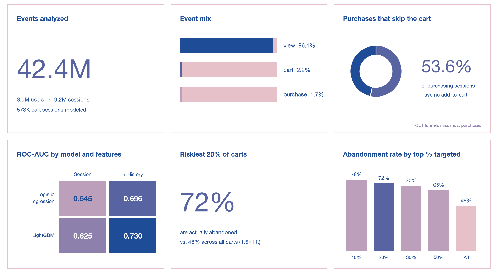
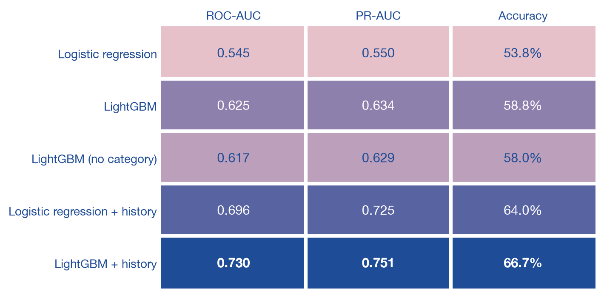

# Cart Abandonment Prediction

Predicting whether an online shopper who adds an item to the cart will complete the purchase, using 42 million behavioral events from a multi-category e-commerce store. Data processing and feature engineering are done in SQL (DuckDB); modeling and evaluation in Python (scikit-learn, LightGBM).



## Key findings

- **More than half of purchases bypass the cart.** 53.6% of purchasing sessions have no add-to-cart event, so cart-based funnel metrics miss most purchases.
- **Who the user is matters more than what they do in the session.** Three user-history features raised LightGBM ROC-AUC from 0.625 to 0.730.
- **The model makes reminder targeting 1.5× more precise.** Among the 20% of carts ranked riskiest, 72% are actually abandoned, versus 48% overall.

## Business question

An e-commerce store wants to decide which shoppers should receive a "you left something in your cart" reminder. Since the reminder only applies to shoppers with items in their cart, the analysis covers sessions with at least one add-to-cart event and predicts whether each session ends in a purchase. Purchases made without a cart event are out of scope.

## Data

[eCommerce behavior data from multi category store](https://www.kaggle.com/datasets/mkechinov/ecommerce-behavior-data-from-multi-category-store) (Kaggle). October 2019 only; each row is one event (`view`, `cart`, or `purchase`).

| | |
|---|---|
| Events | 42,448,764 |
| Users | 3,022,290 |
| Sessions | 9,244,421 |
| Period | Oct 1–31, 2019 (UTC) |
| Event mix | view 96.1%, cart 2.2%, purchase 1.7% |

October was chosen because it has no major promotion (November includes Black Friday), which keeps behavior representative and leaves November available as an out-of-time test set.

## Approach

### 1. Data quality

- `category_code` is missing for 31.8% of events, so the fully populated `category_id` is used instead.
- `brand` is missing for 14.4% of events; tested as a feature (`cart_brand_missing`) and found to carry no signal.
- 3.0% of cart events are exact duplicates within the same second (likely double clicks or multiple units). They are kept, since the label depends only on whether a purchase occurred.

### 2. Session-level EDA

| Cart | Purchase | Sessions | Share within cart group |
|---|---|---|---|
| No | No | 8,333,625 | 96.1% |
| No | Yes | 337,699 | 3.9% |
| Yes | No | 281,237 | 49.1% |
| Yes | Yes | 291,861 | 50.9% |

Half of cart sessions convert, and most purchasing sessions never use the cart.

### 3. Label

`label = 1` if the session has a purchase **after** its first add-to-cart.

- 573,097 cart sessions; 50.6% positive, so no resampling is needed.
- Purchases made before the first add-to-cart do not count.

### 4. Features

All features use only information available at the moment of the first add-to-cart, to prevent leakage.

| Group | Features |
|---|---|
| Pre-cart session behavior | views, distinct products viewed, seconds to first add-to-cart |
| Timing | hour, day of week |
| Carted product | price, category (categorical), brand missing |
| User history (earlier sessions only) | prior purchases, prior add-to-carts, prior sessions |

### 5. Validation

Time-based split to mimic predicting future sessions from past data: Oct 1–24 for training (463,222 sessions), Oct 25–31 for testing (109,875 sessions). Predicting "purchase" for every test session gives a 51.98% accuracy baseline.

## Results



*Shading ranks the models within each metric (darker = better).*

- **User history drives most of the gain.** Three history features improved logistic regression by 0.151 and LightGBM by 0.105 in ROC-AUC.
- **LightGBM's advantage comes from non-linearity, not the category feature.** Removing `cart_category_id` lowers ROC-AUC by only 0.008, while LightGBM still beats logistic regression by 0.073 on identical features.
- **Gain importance can mislead.** `cart_category_id` ranks first by gain importance (37.1%, essentially tied with time-to-cart), yet the ablation shows it contributes little on the test set.

## Targeting analysis

Test sessions ranked by predicted abandonment probability (LightGBM + history):

| Top % targeted | Actual abandonment rate | Lift vs. random |
|---|---|---|
| 10% | 76.1% | 1.58 |
| 20% | 72.3% | 1.51 |
| 30% | 69.7% | 1.45 |
| 50% | 64.8% | 1.35 |
| All | 48.0% | 1.00 |

Targeting the top 20% reaches actual abandoners about 72% of the time. The right cutoff depends on reminder cost and budget.

## Limitations

- **Predicts risk, not response.** Whether reminders change behavior requires an A/B test.
- **Same-session label.** Purchases completed in a later session count as abandonment.
- **Left censoring.** The data starts on Oct 1, so test sessions (late October) show more user history than training sessions, which may make test results slightly optimistic.
- **Default hyperparameters.** LightGBM is untuned.

## Next steps

- Design an A/B test for cart reminders and move toward uplift modeling (who is persuadable, not just who is at risk).
- Evaluate on November 2019 to test robustness to the Black Friday shift.
- Add September 2019 data to reduce left censoring.
- Explore the non-linear relationship between time-to-cart and purchase.

## Repository structure

```
├── figures/                         # README figures
├── notebooks/
│   ├── 00_build_model_table.ipynb   # data loading, quality checks, EDA, label and feature tables (SQL)
│   └── 01_model.ipynb               # models, ablation, user-history features, targeting analysis
├── make_readme_figures.py           # generates figures/ from the reported results
├── requirements.txt
└── README.md
```

## How to reproduce

1. Create the data folders: `mkdir -p data/raw data/processed`
2. Download `2019-Oct.csv.gz` from the [dataset page](https://www.kaggle.com/datasets/mkechinov/ecommerce-behavior-data-from-multi-category-store) (linked under "More datasets" in the data card) and place it in `data/raw/`.
3. Install dependencies: `pip install -r requirements.txt`
4. Run `notebooks/00_build_model_table.ipynb`, then `notebooks/01_model.ipynb`.
